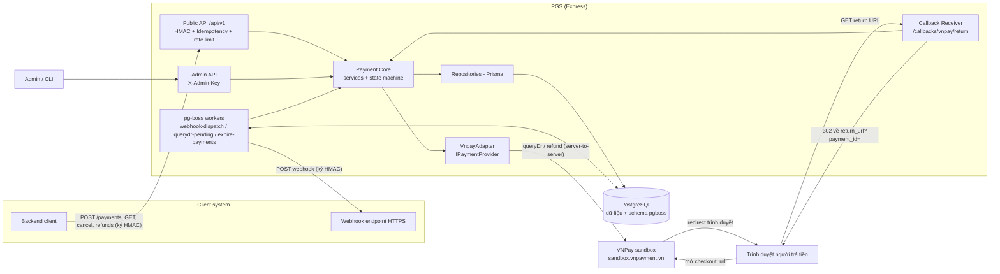
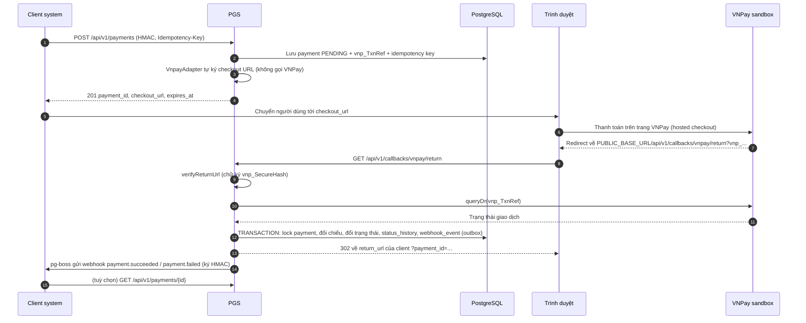
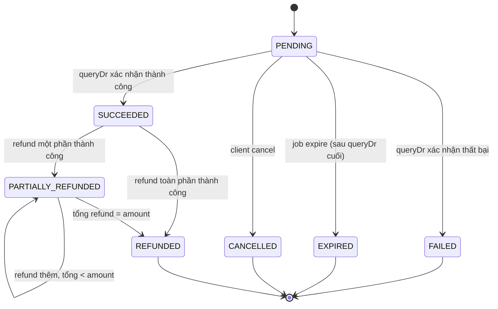

# Kiến trúc — Payment Gateway Service (PGS)

Tài liệu tóm tắt kiến trúc cho bản MVP (VNPay sandbox). Nguồn yêu cầu: [`docs/srs.md`](srs.md). Thứ tự ưu tiên khi mâu thuẫn: quyết định user đã chốt (mục [9](#9-quyết-định-bổ-sung-2026-10-21)) → SRS → tài liệu này (ví dụ: user đã loại opossum dù SRS NFR-REL-04 có nhắc tới). Điểm nào còn chờ user chốt được đánh dấu "(chờ chốt – xem Câu hỏi mở)" và **chưa phải quyết định**; danh sách ở mục [Câu hỏi mở](#10-câu-hỏi-mở).

Stack và danh sách thư viện được phép: xem [`CLAUDE.md`](../CLAUDE.md). Quy tắc API (HMAC, lỗi, idempotency): [`.claude/rules/api-design.md`](../.claude/rules/api-design.md). Checklist bảo mật: [`.claude/rules/security.md`](../.claude/rules/security.md).

## 1. Thành phần

Theo SRS mục 2. Cột "MVP" cho biết phần nào được làm ở giai đoạn sandbox.

| Thành phần | Vai trò | MVP | Vị trí code dự kiến |
| --- | --- | --- | --- |
| Public API (REST) | Endpoint cho client system, xác thực API key + HMAC, `Idempotency-Key` cho mọi POST của client | Có | `src/routes`, `src/controllers`, `src/middlewares/hmac-auth.ts`, `idempotency.ts` |
| Payment Core | Nghiệp vụ payment/refund, state machine, idempotency, lock theo payment | Có (refund toàn phần; partial refund là S) | `src/services`, `src/repositories` |
| Provider Adapters | Mỗi provider cài `IPaymentProvider`; MVP chỉ `VnpayAdapter` (thư viện `vnpay`) | Có (chỉ VNPay sandbox) | `src/providers/IPaymentProvider.ts`, `src/providers/vnpay/VnpayAdapter.ts`, `registry.ts` |
| Callback Receiver | `GET /api/v1/callbacks/vnpay/return`: verify chữ ký → queryDr → cập nhật | Có (chỉ return URL) | `src/routes`, `src/controllers`, `src/services` |
| Endpoint IPN | `POST /api/v1/callbacks/{provider}/ipn` | **Không** (giai đoạn 2, xem ADR 0002) | — |
| Webhook Dispatcher | Gửi sự kiện có ký HMAC tới client, retry exponential backoff | Có | `src/jobs/webhook-dispatch.ts` |
| Job queryDr | Hỏi lại VNPay cho payment PENDING quá N phút | Có | `src/jobs/querydr-pending.ts` |
| Job expire | Chuyển PENDING quá hạn sang EXPIRED (sau một lần queryDr cuối) | Có | `src/jobs/expire-payments.ts` |
| Reconciliation Job | Đối soát hằng ngày với provider | **Không** (mức S, giai đoạn 2) | — |
| Admin API | Quản lý client, cấu hình provider, gửi lại webhook; xác thực `X-Admin-Key` | Có (phần mức M) | `src/routes/admin*`, `src/middlewares/admin-auth.ts` |
| CLI seed | Tạo client không cần deploy lại (FR-MT-04) | Có | `src/cli/seed-client.ts` |
| Hạ tầng | Chỉ PostgreSQL: dữ liệu, idempotency, advisory lock, hàng đợi pg-boss. Không Redis/RabbitMQ | Có, chạy local bằng Docker Compose | `prisma/`, `docker-compose.yml` |

Phân lớp bắt buộc: **route → controller → service → repository**; service chỉ gọi provider qua `IPaymentProvider` (lấy từ `registry`), không import trực tiếp thư viện `vnpay`. Thêm provider mới = thêm adapter + cấu hình, không sửa Payment Core (FR-PV-03, NFR-EXT-01). App được tạo bằng `createApp(deps)` để test inject được tầng HTTP transport ra VNPay.

## 2. Sơ đồ

## 3. Luồng thanh toán sandbox

Chi tiết từng bước:

1. **Tạo payment.** Client gọi `POST /api/v1/payments` có ký HMAC và `Idempotency-Key`. PGS xác thực, lấy `client_id` từ client đã xác thực (không từ body), kiểm tra client được dùng `vnpay` (FR-CL-04), validate bằng zod (số tiền integer, VND, `return_url` hợp lệ — quy tắc giới hạn `return_url` (chờ chốt – xem Câu hỏi mở C10)). PGS sinh `vnp_TxnRef` duy nhất toàn hệ thống (cột `provider_txn_ref`), lưu payment `PENDING` với `expires_at`, lưu response vào `idempotency_keys`.
2. **PGS tự ký URL.** `VnpayAdapter` dùng thư viện `vnpay` để tạo `checkout_url` trỏ tới `sandbox.vnpayment.vn`, với `vnp_ReturnUrl = PUBLIC_BASE_URL + /api/v1/callbacks/vnpay/return`. Bước này **không gọi mạng** tới VNPay. Trả `201 { payment_id, status, checkout_url, expires_at }`.
3. **Người dùng thanh toán** trên trang VNPay; PGS không thấy dữ liệu thẻ.
4. **VNPay redirect** trình duyệt về `GET /api/v1/callbacks/vnpay/return?vnp_...`. Endpoint này không có HMAC client (trình duyệt gọi), nên mọi tham số đều là dữ liệu không tin cậy.
5. **Verify chữ ký** bằng `verifyReturnUrl`. Sai chữ ký: không đổi trạng thái, ghi log (đã che), redirect an toàn. Payload có thể lưu vào `provider_callbacks` với `signature_valid`.
6. **queryDr.** Chữ ký hợp lệ vẫn chưa đủ: PGS gọi `queryDr` tới VNPay sandbox để xác nhận trạng thái thật (FR-CB-02). Lỗi/timeout queryDr → giữ `PENDING`, để job queryDr xử lý sau. Mã kết quả VNPay nào được coi là thất bại xác định để chuyển FAILED (chờ chốt – xem Câu hỏi mở C11).
7. **Đối chiếu** (FR-CB-03): `vnp_Amount / 100 === payment.amount`, `vnp_TxnRef === payment.provider_txn_ref`, `vnp_TmnCode` đúng merchant, kết quả queryDr khớp. Sai lệch → đặt cờ `needs_review = true`, **không** chuyển SUCCEEDED, ghi log cảnh báo. Cách xử lý tiếp payment có `needs_review` (chờ chốt – xem Câu hỏi mở C6).
8. **Cập nhật trạng thái + outbox** trong **một transaction DB** (NFR-REL-01): lock payment (`SELECT ... FOR UPDATE` hoặc advisory lock), chỉ chuyển nếu đang `PENDING` (idempotent, FR-CB-04), ghi `transactions`, `payment_status_history` (source `api`/`job`), và chèn `webhook_events` (`payment.succeeded`/`payment.failed`). Cách bản ghi outbox kích hoạt job pg-boss (chờ chốt – xem Câu hỏi mở C12).
9. **Redirect về client.** 302 tới `return_url` của client, thêm `payment_id` bằng `URL.searchParams` (FR-CB-05). Không chuyển tiếp tham số `vnp_*`. Client lấy trạng thái chính thức qua webhook hoặc `GET /api/v1/payments/{id}`.
10. **Gửi webhook.** Worker pg-boss đọc `webhook_events`, ký HMAC-SHA256 bằng secret của client (giải mã từ `secret_encrypted`) kèm timestamp và `event_id` — tên header và chuỗi ký (chờ chốt – xem Câu hỏi mở C2) — rồi POST tới `webhook_url` với timeout 10 giây; không nhận 2xx thì retry theo lịch SRS mục 7 (ngay, +1m, +5m, +15m, +1h, +3h, +6h, +12h), hết lượt → `FAILED`, admin gửi lại qua `/api/v1/admin/webhooks/{id}/resend`.

### 3.1 Job queryDr cho payment PENDING (FR-CB-06)

- Chạy mỗi phút (pg-boss schedule). Chọn payment `PENDING` có `created_at` quá N phút (mặc định 5) và chưa hết hạn.
- Với từng payment: gọi `queryDr`, rồi đi qua đúng bước 7–8 ở trên (cùng hàm service, source `job`). Đây là đường dự phòng khi người dùng đóng trình duyệt hoặc redirect thất bại.
- Xử lý theo lô, lock từng payment để không đụng với return URL hoặc cancel đang chạy song song. Lỗi provider → bỏ qua, lần chạy sau thử lại.
- Payment có `needs_review` có bị job bỏ qua không (chờ chốt – xem Câu hỏi mở C6).

### 3.2 Job expire (FR-PM-05)

- Chọn payment `PENDING` có `expires_at < now()`.
- **Gọi queryDr một lần cuối** trước khi đánh dấu: nếu VNPay xác nhận thành công → SUCCEEDED (đi qua bước 7–8); nếu không → `EXPIRED` và tạo webhook `payment.expired` trong cùng transaction.
- Nếu sau khi đã EXPIRED mà phát hiện VNPay thực ra đã thu tiền (qua return muộn hoặc đối soát) → không đổi trạng thái cuối; đặt `needs_review = true` để xử lý tay.

## 4. State machine payment

Bảy trạng thái: `PENDING`, `SUCCEEDED`, `FAILED`, `EXPIRED`, `CANCELLED`, `PARTIALLY_REFUNDED`, `REFUNDED`.

| Từ | Sang | Tác nhân (source) | Điều kiện | Webhook |
| --- | --- | --- | --- | --- |
| PENDING | SUCCEEDED | return URL (`api`) / job queryDr (`job`) | Chữ ký hợp lệ + queryDr thành công + đối chiếu khớp | `payment.succeeded` |
| PENDING | FAILED | return URL / job queryDr | queryDr xác nhận thất bại (tập mã VNPay chờ chốt – xem Câu hỏi mở C11) | `payment.failed` |
| PENDING | EXPIRED | job expire (`job`) | `expires_at` đã qua, queryDr cuối không thành công | `payment.expired` |
| PENDING | CANCELLED | client `POST /payments/{id}/cancel` (`api`) | Đang PENDING | Có sự kiện `payment.cancelled` hay không (chờ chốt – xem Câu hỏi mở C7) |
| SUCCEEDED | REFUNDED | refund (`api`) | Refund toàn phần thành công | `refund.succeeded` |
| SUCCEEDED | PARTIALLY_REFUNDED | refund (`api`) | Refund một phần thành công (mức S) | `refund.succeeded` |
| PARTIALLY_REFUNDED | PARTIALLY_REFUNDED / REFUNDED | refund (`api`) | Tổng refund ≤ amount | `refund.succeeded` |

Quy tắc:

- `PENDING` là trạng thái duy nhất đổi được trước thanh toán. `FAILED`, `EXPIRED`, `CANCELLED` là trạng thái cuối; `REFUNDED` không còn chuyển tiếp.
- Mọi chuyển khác trả `409 INVALID_STATE`. Mọi lần chuyển ghi `payment_status_history` (`from_status`, `to_status`, `source`: `api`/`job`/`admin`; `ipn` dành cho giai đoạn sau).
- Sai lệch số tiền/mã (FR-CB-03) là cờ `needs_review`, **không** phải trạng thái.
- Refund thất bại không đổi trạng thái payment và phát `refund.failed`. Trạng thái refund: `PENDING`, `SUCCEEDED`, `FAILED` là **bổ sung** của tài liệu này (SRS chỉ nêu `MANUAL_REQUIRED`, mức S, FR-RF-04); `MANUAL_REQUIRED` thêm khi làm FR-RF-04.
- FR-PM-04: một `(client_id, order_id)` chỉ có tối đa một payment đã thanh toán, bằng partial unique index trong Postgres — phạm vi điều kiện của index (chờ chốt – xem Câu hỏi mở C5).

## 5. Multi-tenant

- Một instance dùng chung cho mọi client system. `client_id` luôn lấy từ client đã xác thực; **không** tin `client_id` trong body/query (FR-MT-01).
- Mọi bảng nghiệp vụ gắn `client_id` (trực tiếp hoặc qua `payment_id`); mọi truy vấn repository nhận `clientId` làm tham số bắt buộc. Tài nguyên của client khác trả `404 NOT_FOUND` (diễn giải SRS 4.4 + FR-QR-03: không trả 403 để tránh lộ sự tồn tại).
- `order_id` chỉ unique trong phạm vi một client; mã gửi VNPay `vnp_TxnRef` do PGS sinh, unique toàn hệ thống (FR-MT-02).
- `idempotency_keys` có PK `(client_id, key)`.
- Mặc định mọi client dùng chung một merchant VNPay (`provider_config_id = null`); merchant riêng là mức S.
- Rate limit theo `client_id` đã xác thực (NFR-SEC-05). Nơi lưu bộ đếm (chờ chốt – C13): đề xuất bộ nhớ trong process cho MVP một instance, nhưng phương án này lệch NFR-REL-03 (stateless, nhiều instance). Mã lỗi khi vượt giới hạn (chờ chốt – xem Câu hỏi mở C3).

## 6. Mô hình dữ liệu (tóm tắt)

Theo SRS mục 5. Mọi bảng có `created_at`, `updated_at`. Không có bảng subscription: client tự quản lý subscription và gắn `subscription_id`, `period`… vào `metadata` (lưu nguyên văn, trả lại trong webhook — FR-SB-01).

| Bảng | Trường chính | Ghi chú |
| --- | --- | --- |
| `clients` | id, name, api_key_hash (SHA-256), secret_encrypted (AES-256-GCM), webhook_url, webhook_events, status, provider_config_id | Khóa mã hóa từ env `ENCRYPTION_KEY` (NFR-SEC-02). Trong Prisma, trường của cột `webhook_events` đặt tên `subscribedEvents` và `@map("webhook_events")`, để tránh trùng tên với bảng `webhook_events` |
| `providers` | code, name, capabilities (JSON), status | Bật/tắt không cần deploy |
| `provider_configs` | id, provider_code, environment, credentials (mã hóa), status | MVP: VNPay sandbox |
| `client_providers` | client_id, provider_code, is_enabled | PK (client_id, provider_code) |
| `payments` | id, client_id, order_id, amount (integer), currency, status, provider_code, provider_txn_ref, description, return_url, metadata, expires_at, paid_at, needs_review | `provider_txn_ref` unique toàn hệ thống; unique (client_id, order_id) cho payment đã thanh toán (phạm vi chờ chốt – xem Câu hỏi mở C5); `needs_review` là cột bổ sung theo quyết định 2026-10-21 |
| `transactions` | id, payment_id, provider_code, provider_txn_id, amount, status, raw_request, raw_response | unique (provider_code, provider_txn_id); raw không chứa secret |
| `refunds` | id, payment_id, amount, reason, status, provider_refund_id | Tổng refund ≤ amount; giá trị `status` xem mục 4 |
| `provider_callbacks` | id, provider_code, payload, signature_valid, processed, received_at | MVP lưu return URL; IPN dùng sau |
| `webhook_events` | id (event_id), client_id, type, payload, status, attempts, next_retry_at, last_response | Outbox, ghi cùng transaction với đổi trạng thái |
| `idempotency_keys` | client_id, key, request_hash, response, expires_at | PK (client_id, key), hết hạn 24h; có cache response lỗi hay không (chờ chốt – xem Câu hỏi mở C9) |
| `payment_status_history` | id, payment_id, from_status, to_status, source | Audit mọi lần đổi trạng thái |
| `reconciliation_items` | id, date, provider_code, provider_txn_id, issue_type, resolved | Giai đoạn 2 |
| schema `pgboss` | do pg-boss tự tạo | Hàng đợi webhook và job |

## 7. Xác thực

| Kênh | Cơ chế |
| --- | --- |
| Client → Public API | API key + HMAC (NFR-SEC-01). Header `X-Client-Id`, `X-Timestamp`, `X-Signature`; chuỗi ký, đơn vị timestamp, encoding: theo [`.claude/rules/api-design.md`](../.claude/rules/api-design.md) mục "Xác thực HMAC" (tóm tắt: `METHOD` viết hoa + `req.originalUrl` gồm `/api/v1` và query + timestamp Unix giây + raw body, hex chữ thường). Lệch > 5 phút → `401 INVALID_SIGNATURE`; so sánh bằng `crypto.timingSafeEqual`. Header mang API key (chờ chốt – xem Câu hỏi mở C1). `Idempotency-Key` bắt buộc với mọi POST của client; thiếu → `400 VALIDATION_ERROR` (diễn giải SRS 4.4) |
| Admin → `/api/v1/admin/*` | Header `X-Admin-Key` so sánh timing-safe với env `ADMIN_API_KEY`, chỉ dùng cho local/sandbox. `ADMIN_API_KEY` **bắt buộc**: app fail-fast khi khởi động nếu thiếu hoặc ngắn hơn 32 ký tự. Mã lỗi khi sai khóa (chờ chốt – xem Câu hỏi mở C3); POST admin có cần `Idempotency-Key` (chờ chốt – xem Câu hỏi mở C8) |
| VNPay → return URL | Chữ ký `vnp_SecureHash` (verify bằng thư viện `vnpay`, khóa `VNP_HASH_SECRET`) + queryDr |
| PGS → webhook client | HMAC-SHA256 bằng secret của client, kèm timestamp và `event_id`; định dạng cụ thể (chờ chốt – xem Câu hỏi mở C2) |

## 8. Quy trình bảo mật

Thay đổi code thuộc auth, payment, callback, webhook, refund hoặc cấu hình bảo mật → chạy subagent `security-auditor` (`.claude/agents/security-auditor.md`), rồi `security-verifier` (`.claude/agents/security-verifier.md`) trên báo cáo vừa tạo. Báo cáo nằm ở `docs/security/reports/`, test tái hiện ở `tests/security/<finding-id>.test.ts`. Chi tiết trong `CLAUDE.md`.

## 9. Quyết định bổ sung 2026-10-21

1. **Lưu thông tin xác thực client:** `api_key_hash` (SHA-256) và `secret_encrypted` (AES-256-GCM, khóa từ env `ENCRYPTION_KEY`), theo SRS mục 5 và NFR-SEC-02. Secret được mã hóa hai chiều vì cần giá trị gốc để verify HMAC request và ký webhook.
2. **Payment có 7 trạng thái**: PENDING, SUCCEEDED, FAILED, EXPIRED, CANCELLED, PARTIALLY_REFUNDED, REFUNDED. FAILED/EXPIRED/CANCELLED là trạng thái cuối; PENDING là trạng thái duy nhất đổi được trước thanh toán. Sai lệch số tiền/mã (FR-CB-03) đặt cờ `needs_review`, không phải trạng thái.
3. **Admin API** `/api/v1/admin/*` xác thực bằng header `X-Admin-Key`, so sánh timing-safe với env `ADMIN_API_KEY` (chỉ cho local/sandbox).
4. **Thư viện được phép** giới hạn theo danh sách trong [`CLAUDE.md`](../CLAUDE.md). Hệ quả: log JSON tự viết (có mask), retry/timeout/circuit breaker tự viết (thay cho opossum trong NFR-REL-04), không dùng helmet.
5. **SRS đổi tên thành `docs/srs.md`**.

Các điểm chốt trong vòng rà soát Phase 1 (không phải câu trả lời của user ngày 2026-10-21): chuỗi ký HMAC (theo `.claude/rules/api-design.md`); `ADMIN_API_KEY` bắt buộc, app fail-fast khi khởi động nếu thiếu hoặc ngắn hơn 32 ký tự (mục 7); trạng thái refund bổ sung (mục 4); tên trường Prisma `subscribedEvents` (mục 6).

## 10. Câu hỏi mở

Các điểm dưới đây **chờ user chốt**. Phương án đề xuất chỉ là gợi ý; code ở Phase 2 không được coi là quyết định cho đến khi user trả lời. Khi chốt, chuyển điểm đó lên mục 9 và bỏ nhãn "(chờ chốt …)" ở các chỗ liên quan.

| # | Câu hỏi | Phương án đề xuất |
| --- | --- | --- |
| C1 | API key gửi bằng header nào? SRS 4.2 chỉ có `X-Client-Id`. | (a) Thêm header `X-Api-Key`, PGS tra client theo SHA-256 của key; hoặc (b) gộp: `X-Client-Id` là id công khai, API key chính là `client_id` (bí mật thật sự chỉ là secret HMAC). |
| C2 | Định dạng chữ ký webhook gửi tới client. | Header `X-PGS-Event-Id`, `X-PGS-Timestamp`, `X-PGS-Signature = hex(HMAC-SHA256(secret, timestamp + "." + rawBody))`. |
| C3 | Mã lỗi bổ sung ngoài SRS 4.4. | `429 RATE_LIMITED`, `500 INTERNAL_ERROR`, `401 UNAUTHORIZED` cho admin, `409 IDEMPOTENCY_CONFLICT` với `details.reason = "in_progress"` khi request trùng key đang xử lý. |
| C4 | Finding Medium/Low đã CONFIRMED có được để lại (chưa sửa) không? | Được, nếu user chấp nhận rõ ràng và được ghi vào `tests/security/open-findings.json`; High/Critical không bao giờ được để lại. |
| C5 | Phạm vi unique của FR-PM-04. | Partial unique index `(client_id, order_id) WHERE paid_at IS NOT NULL`, phủ cả SUCCEEDED, PARTIALLY_REFUNDED, REFUNDED. |
| C6 | Payment có `needs_review` xử lý thế nào? | Giữ `PENDING`; job queryDr/expire bỏ qua; không bắn webhook; admin xử lý tay. |
| C7 | Có thêm sự kiện `payment.cancelled` không? | Không ở MVP. |
| C8 | `POST /api/v1/admin/*` có cần `Idempotency-Key` không? | Miễn. |
| C9 | Có cache response lỗi theo idempotency key không? | Cache 2xx/4xx; với 5xx/502/504 thì giải phóng key để client thử lại. |
| C10 | Giới hạn `return_url`. | Chỉ `https:` (cho phép `http://localhost` khi chưa production); hoặc allowlist domain theo từng client. |
| C11 | Mã VNPay nào dẫn tới FAILED (vd `24` = người dùng hủy)? | FAILED chỉ khi queryDr trả kết quả thất bại xác định; mọi trường hợp khác giữ PENDING (job queryDr/expire xử lý tiếp). |
| C12 | Outbox kích hoạt pg-boss thế nào? | (a) Gọi `send` của pg-boss trong cùng transaction DB với việc ghi `webhook_events`; hoặc (b) job định kỳ quét `webhook_events` đang chờ gửi rồi tạo job. |
| C13 | Rate limit lưu bộ đếm ở đâu? (bộ nhớ process lệch NFR-REL-03) | Bộ nhớ trong process, chạy một instance ở MVP; khi scale ngang thì chuyển bộ đếm sang Postgres. |

Xem thêm: [ADR 0001 — Express + PostgreSQL + pg-boss](adr/0001-express-postgres-pgboss.md), [ADR 0002 — Sandbox không IPN](adr/0002-sandbox-khong-ipn.md).
